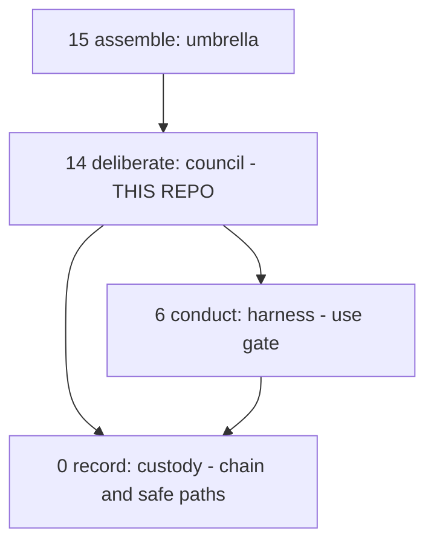
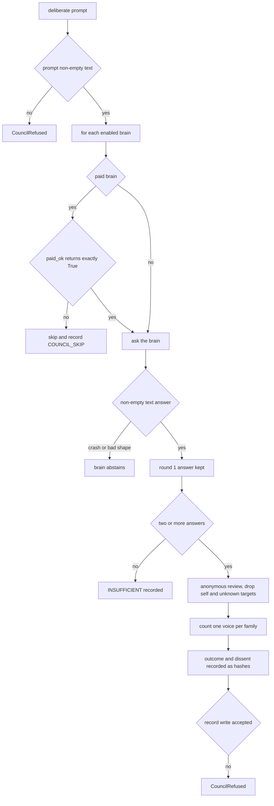
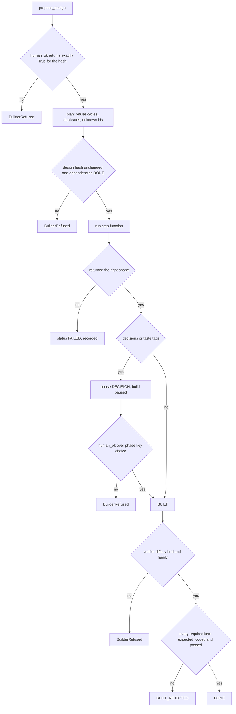
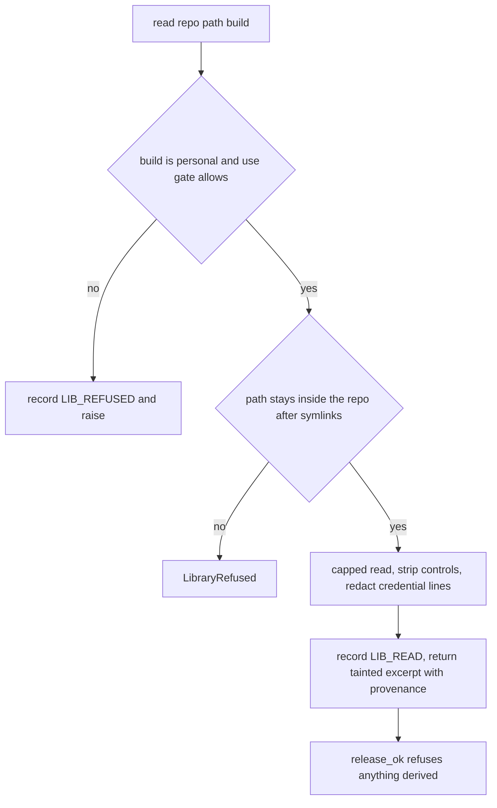

# vega-council-sdk — Architecture

**Contents:** [Layer map](#where-it-sits) · [Components](#components) · [Deliberation workflow and its stops](#deliberation-workflow-and-where-it-fails-closed) · [Build workflow and its stops](#build-workflow-and-where-it-fails-closed) · [Library workflow](#library-workflow-and-where-it-fails-closed) · [Custom constraints](#custom-constraints)

## Where it sits



```
 15 assemble   vega-umbrella-sdk
>>> 14 deliberate vega-council-sdk   <-- THIS REPO
  6 conduct    vega-harness-sdk      (dependency)
  0 record     vega-custody-sdk      (dependency)
```

## Components

| Module | Concern | Uses |
|---|---|---|
| `deliberation` | Equal brains, anonymous review, dissent carried | custody `Dag.record` |
| `builder` | Approved design, human taste, independent verification | custody `Dag.record` |
| `library` | Gated reference reads, tainted provenance | custody `safepaths`, `Dag`, harness `use_gate` |

## Deliberation workflow and where it fails closed



| Stop point | Mechanism | Where |
|---|---|---|
| Bad prompt | raise | `Council.deliberate` |
| Paid brain without commitment | deny by default, skip, record | `Council._paid` |
| Bad brain output | abstain | `Council.deliberate` |
| Too few answers | INSUFFICIENT, no winner invented | `Council.deliberate` |
| Record refused | raise | `Council._rec` |

## Build workflow and where it fails closed



| Stop point | Mechanism | Where |
|---|---|---|
| No human approval | raise | `Builder.approve` |
| Design changed | raise on build | `Builder.build` |
| Taste decision | pause until a human decides | `Builder.build`, `Builder.decide` |
| Self-verification | raise | `Builder.verify` |
| Required item fails | BUILT_REJECTED | `Builder.verify` |

## Library workflow and where it fails closed



## Custom constraints

Extension points in the published code: the brain functions, `paid_ok`, `human_ok`, the checklist contents and the licence matrix passed to `ReferenceLibrary`. User-defined constraints may be STRICTER than the legal minimum for the applicable jurisdiction, never looser. Jurisdictional legal minimums are defined by the jurisdiction registry (vega-jurisdiction-sdk); a custom constraint that would drop below a registered minimum is rejected at the gate.
