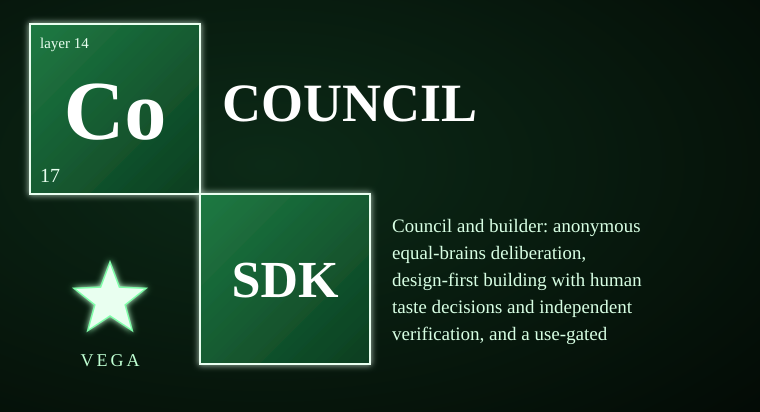

# vega-council-sdk

<!-- vega-install-order -->
> **Build order: 5/5. This kit needs 4 other Vega kits installed first.** Install them in this order, then this one:
> 1/5 `vega-custody-sdk`  
> 2/5 `vega-governance-jacket-sdk`  
> 3/5 `vega-librarian-sdk`  
> 4/5 `vega-harness-sdk`  
> 5/5 `vega-council-sdk` (this kit)
> Install each with `pip install --no-deps git+https://github.com/jasonblasiak868-code/<name>` in the order shown, plus `pip install cryptography`. Full steps: [INTEGRATION_GUIDE](https://github.com/jasonblasiak868-code/vega-umbrella-sdk/blob/main/INTEGRATION_GUIDE.md).

**Deliberation and building that a person can audit.** Several AI "brains" answer the same question, review each other anonymously, and the outcome always carries its dissent. A build pipeline then turns an approved design into verified work, where a human holds every taste decision and whoever built a phase can never be the one to verify it. This kit owns one concern in the Vega family: **structured multi-brain deliberation and design-first building**.

> **Licensing.** Source-available, not open source. Free for personal use; free for registered small businesses (under US$1M revenue and valuation); everyone else needs a commercial license (see LICENSE; for a commercial license write to jasonblasiak.ai.mail@gmail.com). Patent pending. Draft licence text, not yet reviewed by an attorney.

## At a glance

| | |
|---|---|
| Package | `vega_council` (src layout) |
| Version | 0.1.0 |
| Layer | 14 of 16, deliberate |
| Depends on | vega-custody-sdk, vega-harness-sdk |
| Python | 3.10 or newer, pure Python, no network code |
| Tests | 64 tests in 5 files, all passing (STATUS.md) |
| Status | Reference implementation, work in progress |

**Contents:** [Why](#why-this-exists) · [Capabilities](#capabilities) · [Flow](#end-to-end-flow) · [Controls](#controls) · [Cannot do](#what-it-cannot-do) · [Platforms](#platform-support) · [Install](#install-standalone-and-unified) · [Diagnostics](#diagnostic-control) · [Fail closed](#fail-closed-and-custom-constraints) · [Family](#where-it-sits-in-the-family) · [Tests](#tests)

## Why this exists

Asking one model for an answer gives you one opinion with no check on it. Asking five copies of the same model gives you the same opinion five times. Letting a model design, build and approve its own work gives you a system that grades itself.

This kit closes those three gaps with structure instead of trust. Brains are equal and anonymous, brains of one family count as one voice, nobody votes for their own answer, and a split is reported as a split. In the builder, a person approves the design before any plan exists, a person makes every taste decision, and a different brain from a different family verifies each phase against a checklist that was written before the build.

## Capabilities

| Capability | Where it lives | How you can check it |
|---|---|---|
| Equal-brain deliberation with anonymous, seed-shuffled cross-review | `deliberation.Council.deliberate` | `tests/test_council.py` |
| One voice per model family, no self-votes, crashing brains abstain | `deliberation.py` | `tests/redteam_1_council_and_builder.py` |
| Outcome never hides dissent: CONSENSUS, CONSENSUS_WITH_DISSENT, CONSENSUS_SEVERAL, SPLIT, INSUFFICIENT | `deliberation.py` | `tests/test_council.py` |
| Paid brains asked only with a human-signed commitment check | `Council._paid`, `paid_ok` | `tests/redteam_1_council_and_builder.py` |
| Design approved by a human hash before planning; plan refuses cycles and unknown ids | `builder.Builder` | `tests/test_council.py` |
| Taste decisions pause the build until a human decides | `Builder.build`, `Builder.decide` | `tests/redteam_1_council_and_builder.py` |
| Verifier must be a different brain and a different family; required proof items must be expected, coded and passed | `Builder.verify` | `tests/test_sharpened.py`, `tests/mutations.py` |
| Quarantined reference library: names always listable, reads personal-build only, scrubbed, recorded and marked tainted | `library.ReferenceLibrary` | `tests/redteam_2_library.py` |
| Every step recorded as hashes and ids on the custody chain, never the content | all modules via `dag.record` | `tests/test_council.py` |

## End-to-end flow

```mermaid
flowchart LR
    P[Prompt] --> A[Round 1: every enabled brain answers]
    A --> R[Round 2: anonymous cross-review]
    R --> T[Count one voice per family]
    T --> O[Outcome with dissent carried]
    O --> H[Human reads the outcome]
    H --> D[Design proposed and hashed]
    D --> AP[Human approves that hash]
    AP --> PL[Plan in dependency order]
    PL --> B[Build a phase]
    B -->|taste decision| HD[Human decides]
    HD --> B
    B --> V[Different brain and family verifies]
    V -->|all required items pass| DONE[Phase DONE]
    V -->|any required item fails| B
```

1. **Ask.** `Council.deliberate(prompt)` sends the same prompt to every enabled brain. No roles, no ranks.
2. **Review.** Each brain sees the others' answers under shuffled anonymous labels and returns a stance on each: VALIDATE, CHALLENGE or EXTEND.
3. **Count.** Votes are counted per family. The bar is a majority of families.
4. **Report.** The result names the outcome, the scores, and any dissent. The chain records hashes and counts, never the answers.
5. **Design.** `Builder.propose_design` hashes a design. `approve` needs a human check that returns exactly `True` for that hash.
6. **Build and verify.** Phases run in dependency order. Taste decisions pause the phase. `verify` needs a different brain of a different family.

## Controls

| Control | What it does |
|---|---|
| `Brain(brain_id, family, answer, review, cost)` | A brain is two functions you supply plus a cost, `free` or `paid`. The kit opens no network connection. |
| `Council(brains, dag, paid_ok)` | 2 to 32 brains. `paid_ok(brain_id, prompt_sha256)` must return exactly `True` to ask a paid brain. |
| `deliberate(prompt, enabled)` | Run one deliberation, optionally on a subset of brains. |
| `Builder(dag)` | The pipeline: `propose_design`, `approve`, `plan`, `build`, `decide`, `verify`, `status`. |
| `human_ok` callables | You wire these to your own human-signed check. Anything other than exactly `True` is a refusal. |
| `ReferenceLibrary(root, dag, matrix)` | `find` lists names. `read` is personal-build only and needs the licence matrix to allow it. |
| `release_ok(provenance)` | Refuses anything derived from a library read. |

## What it cannot do

- **Agreement is not truth.** Five brains can agree and be wrong. The kit reports agreement; it does not check facts.
- **It supplies no brains.** You provide the model functions. No model is bundled and no network call is made.
- **It does not know what taste is beyond a word list.** A taste decision is triggered by a fixed set of words in a phase's tags or by decisions the build declares.
- **The library gate is policy, not legal advice.** An unlisted repo is treated as having no licence.
- **Not production-hardened and not independently security-reviewed.** Passing tests and a clean scan are not proof of safety.
- **Crypto is not expert-reviewed.** The chain primitives come from the custody kit; no expert has reviewed them.
- **The human is still the weak point.** A careless approval passes the gate.

## Platform support

| Platform | Support |
|---|---|
| Windows, macOS, Linux | Runs anywhere CPython 3.10+ runs. No POSIX-only calls were found in this repo. |
| Android, iOS | No native mobile build is published. The SDK is pure Python and can run inside a Python runtime on Android (Termux) or Apple platforms (BeeWare/Kivy) where that runtime supports its dependencies. |
| Hardware keys, GPU | Not used. |

## Install standalone and unified

**Standalone.** `pip install -e .` installs the package. It declares two dependencies, `vega-custody-sdk` and `vega-harness-sdk`, because it records on the custody chain and uses the harness's licence gate for the library. It does not import any other family kit.

**Unified.** Registered in `vega-umbrella-sdk` as layer 14, `deliberate`, requiring custody and harness. The umbrella resolves the wiring between kits.

## Diagnostic control

This version ships no command-line tool and no console script. The control surface is code:

- `Builder.status()` returns per-phase state and whether the build is COMPLETE.
- `Council.deliberate` returns the outcome, scores, skipped paid brains and dissent.
- Every step lands on the custody chain, which you can verify independently.

A diagnostic UI design for this layer exists in the Vega OS interface program; it is not shipped with this package.

## Fail closed and custom constraints

Refusals are exceptions (`CouncilRefused`, `BuilderRefused`, `LibraryRefused`), and a failed record write refuses the action. The full workflow with every refusal point is in [ARCHITECTURE.md](ARCHITECTURE.md).

User-defined constraints may be STRICTER than the legal minimum for the applicable jurisdiction, never looser. Jurisdictional legal minimums are defined by the jurisdiction registry (vega-jurisdiction-sdk); a custom constraint that would drop below a registered minimum is rejected at the gate. The extension points that exist in this version are the supplied brain functions, `paid_ok`, `human_ok`, the checklist items and the licence matrix.

## Where it sits in the family

Layer 14, deliberate. It depends on layer 0 (custody) and layer 6 (harness). One family, one organism: every SDK owns exactly one concern and uses the owner of every other concern instead of growing its own copy. The full map is in [ARCHITECTURE.md](ARCHITECTURE.md).

## Tests

64 tests in 5 files, all passing (STATUS.md). Put this repo's `src` and the `src` of both dependencies on `PYTHONPATH`, then run each file in `tests/`, for example `python tests/test_council.py`.

## Status and honesty

A reference implementation and a work in progress. It has not been independently security-reviewed, and none of the cryptography across the family has had an expert review. See [SPEC.md](SPEC.md), [ARCHITECTURE.md](ARCHITECTURE.md), [CAPABILITIES.md](CAPABILITIES.md) and SECURITY.md.

Patent pending (U.S. provisional application 64/178,949 and others).

This kit details one branch of a broader filed architecture. The remaining branches are the subject of filed disclosures and are outside the scope of this repository.
